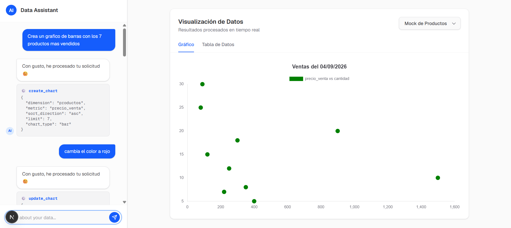

# Fine Tune Model for Function Qwen Chart

Este proyecto tiene como objetivo entrenar un modelo de lenguaje para generar gráficos a partir de descripciones en lenguaje natural. El modelo se basa en la arquitectura Qwen y se ha adaptado para manejar tareas específicas relacionadas con la generación de gráficos.

## Commandos

Para la generacion de los datos sinteticos, se puede ejecutar el siguiente comando:

```bash
modal run generate_dataset.py
```

Para inciar el entrenamiento del modelo, se puede ejecutar el siguiente comando:

```bash
modal run --detach trainer.py
```

Construir modelo con ollama

```bash
ollama create <ModelFile>
```

## Construir con docker

```bash
docker build -t chart-model .
```

Levantando el contenedor con el siguiente comando:

```bash
docker run -it --rm -p 8080:8080 chart-model
```

## Ejecutar servicio

```bash
llama-server.exe -m ./model/lastest/qwen2.5-1.5b-instruct.Q4_K_M.gguf -c 4096 -np 1 -t 6 -tb 6 -fa on --jinja --prio 2 --temp 0.3 --top-p 0.9 --min-p 0.05 --repeat-penalty 1.1
```

## Benchmark

```bash
llama-bench -m ./model\lastest\qwen2.5-1.5b-instruct.Q4_K_M.gguf -t 4,6,8 -p 512 -n 64
```


